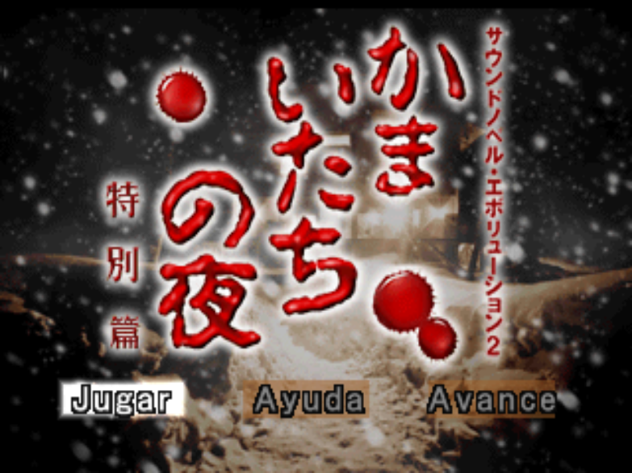
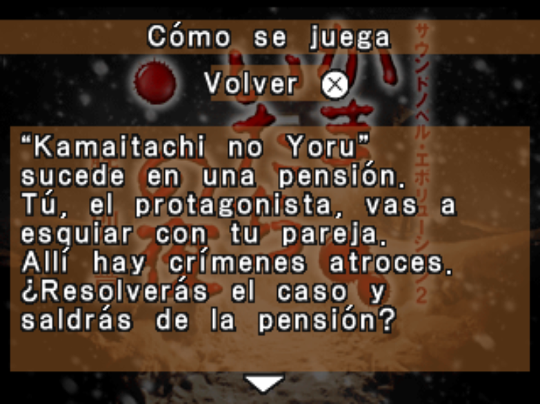
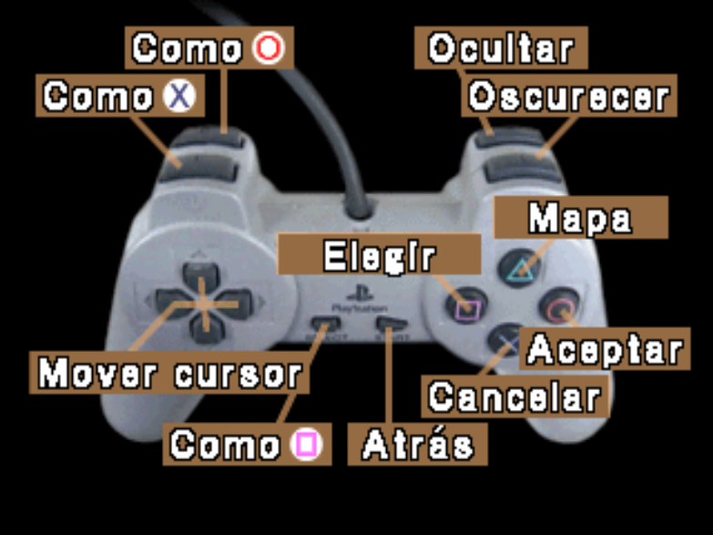
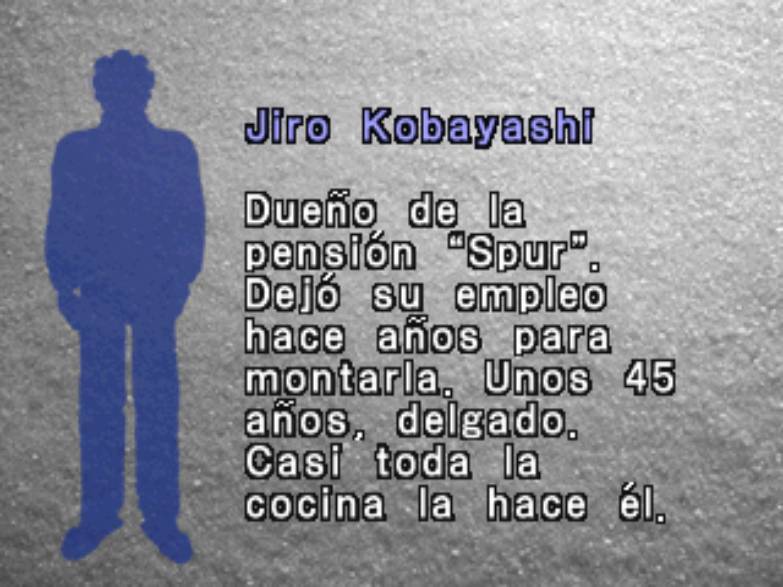
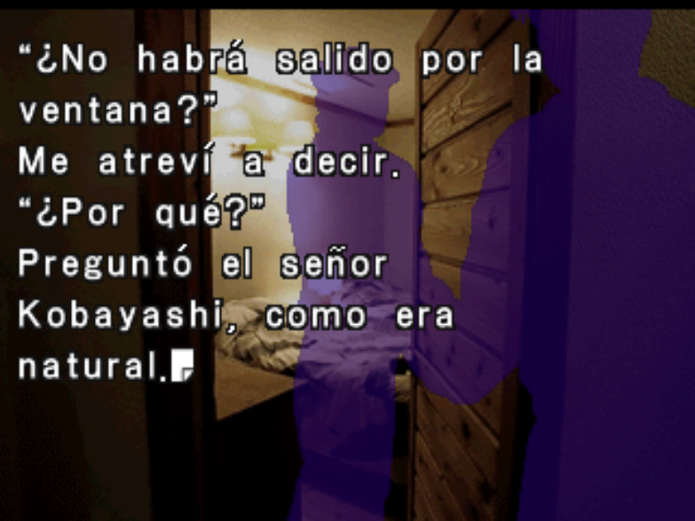
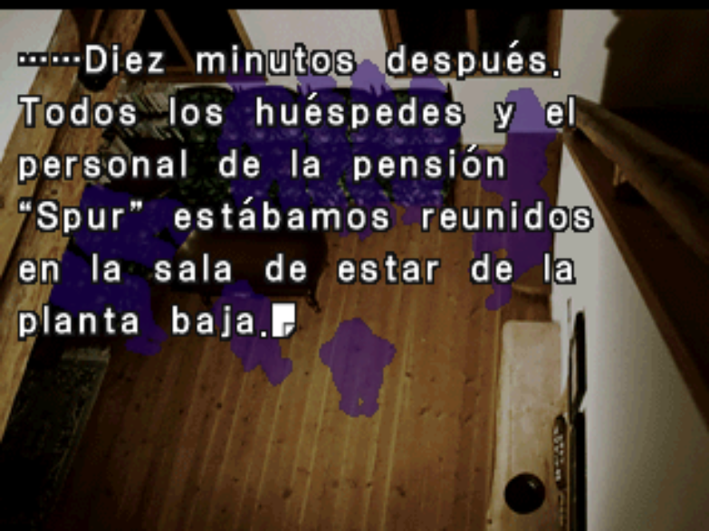

# Kamaitachi no Yoru Tokubetsu-hen (PSX) — Spanish Fan Translation

Work-in-progress fan translation into **Spanish** of *Kamaitachi no Yoru Tokubetsu-hen* (かまいたちの夜 特別篇, *Sound Novel Evolution 2*, SLPS-01794), the Sony PlayStation sound novel by Chunsoft. The whole script (about 15,000 text units in 42 script entries) is translated, together with the menus, the name-entry screen, the save/copy/erase screens, the branch/ending map, the endings list, the "Fin" marks and the controller image.

> **Status: work in progress.** The whole script has had a complete proofreading pass (hito35), but the patch has not been fully playtested yet. Known-good so far: title, story text, name entry, memory card save/load/copy/erase, pause menu and page icons. See [Known issues](#known-issues).
>
> **This repository does not contain the game.** You need your own copy of the original disc image. Everything is generated from it by the scripts below.

## Screenshots

| | |
|---|---|
|  |  |
|  |  |
|  |  |

## Building the translated disc from source

1. **Get this repository** (`git clone`, or "Download ZIP" and extract it).
2. **Install the tools:** [Python 3](https://www.python.org/downloads/) and `pip install capstone unicorn`.
3. **Copy your original disc image** to `rom/Sound Novel Evolution 2 - Kamaitachi no Yoru Tokubetsu-hen (Japan).bin` (create the `rom` folder). It must match:

   | File | Size | CRC32 |
   |---|---|---|
   | `Sound Novel Evolution 2 - Kamaitachi no Yoru Tokubetsu-hen (Japan).bin` | 548,839,200 bytes | `0CA59B07` |

4. **Run the generator** from the repository root:

   ```
   python herramientas/generar_disco.py
   ```

   On Windows, if you get encoding errors, set `PYTHONUTF8=1` first (`set PYTHONUTF8=1`). The script verifies your image, extracts the few files it needs into `extraido/` (never committed), applies the translation and the code patches, and writes the result to `rom/es_completo/` (`.bin` + `.cue`). Open the `.cue` in your emulator. It takes well under a minute. To use another output name, pass it as an argument (without extension): `python herramientas/generar_disco.py rom/mi_disco`.

The build is deterministic: the same inputs always give a byte-identical disc.

## How it works (short version)

- `SCE.PAC` (the script) and `BGD.PAC` (images) are relocated to the end of the disc and the ISO9660 directory is updated, which gives room for the longer Spanish text. Every modified sector gets correct EDC/ECC.
- The font's kana glyphs are replaced with Latin letters (accents, ñ, ¿ ¡) and a proportional layout engine breaks lines and pages for the game's 8-line text window.
- The executable's menus are patched with a 1-byte-per-character printer placed in a small code cave (the menu strings are rebuilt in Spanish).
- Large script entries are split into extra partitions (ids 42–49) and the loader is patched to find them.
- Images (controller map, "Fin" marks) are redrawn with the game's own Latin glyphs.

## Repository contents

| File / folder | What it is |
|---|---|
| `traduccion/es_NN.tsv` | Spanish translation of each script entry (source of truth) |
| `traduccion/exe_textos.tsv`, `mapa_textos.tsv`, `finales_textos.tsv` | Translation of the executable menus, the branch/ending map titles and the endings list |
| `tablas/mapa_caracteres_es.json` | Character → glyph-code map used to write the translated text |
| `herramientas/generar_disco.py` | **Entry point.** Verifies the disc, extracts what is needed and builds the translated disc |
| `herramientas/preparar_extraido.py` | Extracts files from your disc into `extraido/` (executable, `SCE.PAC`, `BIN.PAC`, decompressed script entries, original images) |
| `herramientas/construir_hito.py` | Does the actual work: patches the executable and the script, relocates the PAC files, writes the disc |
| `herramientas/hito.py`, `layout.py`, `particion.py`, `verificador.py`, `revisar_traduccion.py`, `traducir.py`, `opciones.py` | Script handling: text layout, page/line breaking, partitioning of large entries and consistency checks (incl. choice-screen layout and row budget) |
| `herramientas/menus_exe.py`, `menu1b.py`, `parche_exe.py`, `parche_carga.py`, `nombres_es.py` | Executable patches: menus, 1-byte printer, glyph hash table, loader for the extra partitions, name-entry screen |
| `herramientas/mapa_titulos.py` | Branch/ending map titles and endings list |
| `herramientas/mando_es.py`, `fin_es.py` | Controller image and "Fin" marks |
| `herramientas/fuente_kama.py`, `glifos_latinos.py` | Font: adds the Latin glyphs |
| `herramientas/sce_pac.py`, `scriptparse.py`, `deltas.json`, `lzs.py`, `ike_descomprimir.py`, `disco.py` | Formats: PAC archives, script commands, LZSS compressor, `ike` decompressor (runs the game's own routine in Unicorn), PSX sector writer |

Only what is needed to generate the disc is included. The game files, disc images and emulator files are never committed (see `.gitignore`, which only allows the files listed above). Code comments and some identifiers are still in Spanish; an English version of the tools is planned.

## Known issues

- Not everything has been re-tested after every change; only the first screens, the name-entry screen, the save/load flow and the pause menu have been checked in an emulator. Some typos, odd line breaks or untested routes may remain.
- One script page (entry 8, fragment 19) needs more than 8 lines and is known to the checker (`python herramientas/hito.py` reports exactly 1 error because of it).
- Unconfirmed: on a Steam Deck (Batocera) the game closed itself twice at the same line of entry 27 (a scene with a heavy snow effect, where the game itself drops to about 20 FPS). It did not happen in DuckStation on PC and the scene was later passed on the Deck. The cause is not known: it is suspected to be an emulator/game issue in that scene, but it has not been checked against the original ROM, so the patch is not ruled out.
- Cosmetic: on the name-entry screen the brown frame behind the "Borra" button is slightly too small for the label plus its icon (still readable).

## Changelog

Build numbers (hitoNN) are internal disc versions used during development; nothing has been released yet.

- **hito33:** full line-by-line proofreading pass of the Spanish script (entries 0–41, ~15,000 lines read against the Japanese). 15 translated lines that the game was silently dropping (their index was beyond the number of Japanese text units in the fragment) were restored by realigning 13 fragments, and two more misaligned fragments were fixed. Spain-only vocabulary (aparcamiento, carnet, jersey, fregona, tirita, escayola, lentilla, "mal rollo", "todo el rato"…) was replaced with neutral Latin American Spanish, about 80 present-perfect forms in dialogue were turned into the simple past, and literal or awkward renderings and lost jokes were rewritten. Four choice screens that went over 9 rows after the fixes were shortened. Typographic single quotes in `es_06.tsv` (missing from the font, they crashed the layout tool) were replaced with plain apostrophes.
- **hito34:** fixed choice screens being cut off (e.g. only option A visible): the question now stays whole and the options move to a clean page when question + options exceed 9 rows. Removed the blank row between lines of an option, fixed glued words at line ends, and reworded a few lines.
- **hito35:** every choice question now starts on a clean page (the text before it ends the page, not just the line), and a validator that runs the real game text printer (`sim_motor.py`, `valida_motor.py`) checks that all choice screens fit.
- **hito36:** 22 short explanatory notes for Japanese terms and cultural references (onigiri, rokurokubi, tanuki, Shinano, Muramasa, Halcion, Ikkyu…), written inline as a green parenthesis (`{C3}(…){C0}`) using the game's own text colour codes; none were added to choice screens.
- **hito30–hito32:** corrected the choice-screen model: the game prints *every* text unit of the fragment an option jumps to (up to the first 0x15 opcode), not only the first one, so all of them are now narrowed to the label width and counted against the 9-row budget (22 screens shortened). Removed 162 doubled line breaks (`{r}{p}` appended to units whose original tail already had `r`). Fixed two latent page overflows (entries 2 and 36).
- **hito28:** Latin American register pass (no *vosotros*, no *vale/venga/anda/coger/chaval* as filler) over about 190 lines.
- **hito27:** redesigned all choice screens (211 screens, 505 options): one space between the option letter and its text, line fitting at the real 264-px wrap width, and a row budget of 9 per screen. Fixed 18 translation lines that overwrote the option-letter units (the letter disappeared).
- **hito26:** same disc as hito25; the build now runs on a clean checkout (no hard-coded paths, no savestate needed) and regenerates everything from the original disc.
- **hito25:** fixed the page-end icon (the blank-glyph code collided with the game's own icon code).
- **hito24:** fixed a thin black vertical line next to the circle icon in the controller image.
- **hito23:** fixed the freeze after saving and the black screen after deleting/copying/loading a book: code caves had been placed inside the memory-card header buffer, so saving overwrote code. The caves now live in a safe RAM area.
- **hito21:** default names (Toru/Mari) shown correctly.
- **hito11–hito20:** 11-px blank glyph for spaces (the engine advanced only 3 px for the ideographic space), pause menu and card-header layout, name-entry screen and menu fixes.
- **hito5–hito10:** relocated `SCE.PAC`/`BGD.PAC`, LZSS compressor, branch/ending map titles, endings list, name-entry screen, controller image, "Fin" marks.
- **First builds:** script extraction and re-insertion, Latin glyphs added to the font, proportional text layout, partitioning of large entries.

## Credits

- Translation and ROM hacking: **Talion**.
- Tools: Python, [Capstone](https://www.capstone-engine.org/), [Unicorn](https://www.unicorn-engine.org/), [DuckStation](https://www.duckstation.org/) for testing.
- License: [GNU GPL v3](LICENSE).

## Legal

This is an unofficial fan project, not affiliated with or endorsed by the original developers or publishers. *Kamaitachi no Yoru* and all related rights belong to their respective owners. No game data is distributed here: the scripts only work on a disc image that you must supply yourself.
